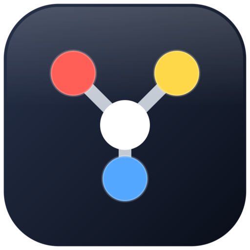

<p align="center">
  
</p>

<h1 align="center">Nico Apple MCP</h1>

<p align="center">
  Let your AI assistant run Apple Calendar, Notes, and Contacts on your Mac, without editing the wrong meeting.
</p>

<p align="center">
  <a href="https://github.com/proxynico/nico-apple-mcp/actions/workflows/ci.yml"></a>
  
  
</p>

<p align="center">
  
</p>

Nico Apple MCP is a local [MCP](https://modelcontextprotocol.io/) server. It connects Claude Code, Codex, Claude Desktop, or any other MCP client to the Calendar, Notes, and Contacts apps already on your Mac. The server runs on your Mac and makes no network calls of its own, and there's no account or API key.

## Why this one

- **It changes the event you meant.** Every event, note, and contact comes back with an ID, and edits use it. When two items share a name, such as five events called "Lunch", it refuses to guess and asks for the ID.
- **Repeating meetings are safe.** Moving this week's stand-up moves this week's stand-up, not the whole series.
- **Calendar goes straight to macOS.** A small signed helper app uses Apple's own calendar framework, EventKit, instead of scripting the Calendar app, so it's fast and never opens Calendar on your screen.
- **It previews before it writes.** Every tool that creates, changes, or deletes something takes `dryRun: true` to show what would happen first.
- **It's quick.** Measured on a Mac mini:

  | Task | Time |
  | --- | --- |
  | A month of calendar events | 0.07 s |
  | List 227 notes | 0.2 s |
  | List 335 contacts | 1.5 s |
  | Brief a day of meetings | 0.6 s |

- **It tells you what's wrong.** `doctor` checks every permission and dependency in one go.

## Meeting prep

Ask your assistant to *prep me for tomorrow*. `meeting_prep` reads the day's meetings, looks up every attendee in Contacts by email or name, and flags anyone you don't have saved yet:

```text
Thursday, 29 October 2026: 3 events

09:30–10:15  Q4 rate review
Calendar: Work · Where: Zoom
• Priya Shah, Head of Procurement at Harbourline · priya.shah@harbourline.example · +852 5550 1234
• Tom Becker · tom@harbourline.example · not in Contacts
Agenda: Go through the November quote and the new Rotterdam surcharge.

12:00–12:45  Coffee with Mei
Calendar: Personal · Where: Blue Bottle, Central
• Mei Lin (organizer) · mei@lin.example · +852 5550 8899

15:00–16:00  Warehouse walkthrough
Calendar: Work · Where: Kwai Chung Terminal 4
• Daniel Okafor, Operations Director at Kestrel Foods · d.okafor@kestrelfoods.example
• Sam Wu (declined) · sam.wu@kestrelfoods.example · not in Contacts

Not in Contacts yet: Tom Becker <tom@harbourline.example>, Sam Wu <sam.wu@kestrelfoods.example>
```

With `saveNote: true` the brief is also saved to Apple Notes, so it's on your phone when you walk in.

## Things you can ask

- "What's on tomorrow, and who am I meeting?"
- "Prep me for Thursday and save it to Notes."
- "Add everyone from tomorrow's meetings who isn't in my contacts."
- "Move this week's 1:1 with Priya to 4pm. Just this week."
- "Find my note about the Shenzhen trip and add today's update to it."
- "Delete the test event I made earlier. Show me first."

## Tools

| App | Tools |
| --- | --- |
| Calendar | `calendar_list_calendars`, `calendar_search_events`, `calendar_create_event`, `calendar_update_event`, `calendar_delete_event` |
| Notes | `notes_list_folders`, `notes_list`, `notes_search`, `notes_read`, `notes_create`, `notes_append`, `notes_move`, `notes_update`, `notes_delete` |
| Contacts | `contacts_list`, `contacts_search`, `contacts_get`, `contacts_create`, `contacts_update`, `contacts_delete` |
| Across apps | `meeting_prep`, `doctor` |

## Install

You need macOS 14 or newer, [Bun](https://bun.sh/), and Xcode's command line tools (`xcode-select --install`).

```bash
git clone https://github.com/proxynico/nico-apple-mcp.git
cd nico-apple-mcp
bun install
bun run build:swift
```

`bun run build:swift` builds and signs the small **NicoAppleMCPCalendarHelper** app that macOS grants Calendar access to.

Then register it with your assistant, using the full path to your clone.

**Claude Code**

```bash
claude mcp add --scope user nico-apple-mcp -- bun run /path/to/nico-apple-mcp/src/index.ts
```

**Codex**

```bash
codex mcp add nico-apple-mcp -- bun run /path/to/nico-apple-mcp/src/index.ts
```

**Claude Desktop and other clients**

```json
{
  "mcpServers": {
    "nico-apple-mcp": {
      "command": "bun",
      "args": ["run", "/path/to/nico-apple-mcp/src/index.ts"]
    }
  }
}
```

Restart the assistant after registering or updating.

## Permissions

macOS asks before anything can read your Calendar, Notes, or Contacts, and this server can't get around that.

1. Ask your assistant to run `doctor`.
2. Ask it to run `calendar_list_calendars`, and approve the Calendar prompt.
3. Approve the Notes and Contacts prompts the first time those tools run.

If a prompt never appears:

- **Calendar:** System Settings > Privacy & Security > Calendars, and give **NicoAppleMCPCalendarHelper** Full Access.
- **Notes and Contacts:** System Settings > Privacy & Security > Automation, and allow your assistant or terminal app to control Notes and Contacts.

A healthy `doctor` looks like this:

```text
OK bun
OK osascript
OK Notes automation
OK Contacts automation
OK calendar helper
calendar authorization: authorized
OK calendar permission: granted
```

## Working with records

Search results include an `eventId`, `noteId`, or `contactId`. Pass it back to update, move, or delete exactly that item. Exact titles and names still work, but a name that matches more than one item is refused.

Every occurrence of a repeating event shares one `eventId`. To change one occurrence, also pass `windowStart` and `windowEnd` around it. An `eventId` alone for a repeating event is refused rather than guessed.

Dates are ISO 8601. A date without a time means local midnight on your Mac.

```text
2026-05-12
2026-05-12T10:30:00
2026-05-12T10:30:00+08:00
```

## Troubleshooting

Run `doctor` first.

- **Calendar says `notDetermined` or denied:** run `calendar_list_calendars`, approve the prompt, check the Calendars privacy setting above, and restart the assistant.
- **Notes or Contacts fail:** check the Automation privacy setting for the app running the server, and restart the assistant.
- **`doctor` says the calendar helper is older than its source:** run `bun run build:swift`, approve the Calendar prompt again (macOS treats each build as a new app), and restart the assistant.
- **Tools are missing or behave like an old version:** quit old assistant sessions and start a new one so the server reloads.

## How it works

One local MCP server written in TypeScript on Bun. Calendar runs through a signed Swift helper app because macOS grants Calendar access to apps, not to background scripts. Notes and Contacts use Apple's scripting interface, reading whole lists in one request instead of item by item.

## Development

```bash
bun install
bun run build:swift
bun run test        # type check and tests
bun run src/index.ts
```

Before sending a change, also run `doctor` and a quick create, update, and delete on the apps you touched.

## License

MIT
